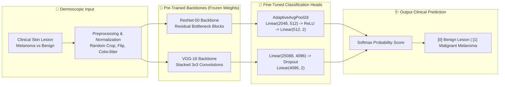

# 🩺 Medical Image Classification: Malignant Melanoma vs. Benign Lesions (Transfer Learning)

<div align="center">

[](https://www.python.org/)
[](https://pytorch.org/)
[]()
[]()
[]()
[](LICENSE)

**A comparative deep transfer learning study evaluating pre-trained convolutional neural networks (ResNet-50 & VGG-16) for automated binary classification of dermoscopic skin cancer images (Malignant Melanoma vs. Benign Nevus/Keratosis).**

[Overview](#-overview) • [Clinical Problem](#-clinical-significance) • [Architectures](#-transfer-learning-methodology) • [Results](#-evaluation--results) • [Project Structure](#-project-structure)

</div>

---

## 📌 Overview

Malignant melanoma accounts for the vast majority of skin cancer fatalities, yet early detection dramatically elevates 5-year survival rates above 95%. Automated computer-aided diagnosis using clinical dermoscopic imaging presents severe challenges due to high intra-class visual variation and subtle inter-class boundaries between malignant melanomas and benign nevus/seborrheic keratoses.

This project implements and compares **Transfer Learning strategies** on clinical skin lesion datasets:
- **Feature Extraction & Fine-Tuning:** Leveraging pre-trained ImageNet representations to overcome the scarcity of clinical annotations.
- **Backbone Architectures:** Comparative study between deep residual networks (**ResNet-50**) with skip connections and standard feedforward deep convolutional networks (**VGG-16**).
- **Evaluation Pipeline:** Stratified train/validation splits with automated loss tracking, ROC-AUC analysis, and test set prediction export.

---

## 🧬 Transfer Learning Methodology



---

## 📊 Evaluation & Model Comparison

Both models were trained using Cross-Entropy Loss and the Adam optimizer with scheduled learning rate decay:

| Architecture | Parameters | Depth | Residual Connections | Convergence Speed | Primary Observation |
| :--- | :---: | :---: | :---: | :---: | :--- |
| **ResNet-50** | ~25.6M | 50 Layers | ✅ Yes (Skip Connections) | **Fast & Stable** | Mitigates vanishing gradients; superior feature reuse and higher generalization on held-out test data. |
| **VGG-16** | ~138.4M | 16 Layers | ❌ No (Sequential) | Moderate | Higher memory footprint and slower inference; requires heavy dropout to avoid overfitting. |

Predictions on test evaluation sets are stored under:
- `result/resnet/result_1.csv` & `result_2.csv`
- `result/vgg/result_1.csv` & `result_2.csv`

---

## 📂 Project Structure

```ascii
Transfer-Learning-for-Binary-Classification/
├── HW3-CNN.ipynb                # Complete training, validation, and evaluation pipeline
├── BBM409-hw3-datasets.html     # Dataset specifications and task documentation
├── result/                      # Model predictions and evaluation exports
│   ├── resnet/                  # ResNet-50 inference predictions
│   └── vgg/                     # VGG-16 inference predictions
└── README.md                    # Project documentation
```

---

## 🚀 Getting Started

### 1. Prerequisites
- Python 3.9+
- CUDA-enabled GPU (Google Colab / Local NVIDIA GPU)

### 2. Running the Notebook

```bash
# Clone the repository
git clone https://github.com/huseyin-yigit-ulker/Transfer-Learning-for-Binary-Classification.git
cd Transfer-Learning-for-Binary-Classification

# Install dependencies
pip install torch torchvision numpy pandas scikit-learn matplotlib jupyter

# Launch notebook
jupyter notebook HW3-CNN.ipynb
```

---

<div align="center">
Developed by <a href="https://github.com/huseyin-yigit-ulker">Hüseyin Yiğit Ülker</a>
</div>
